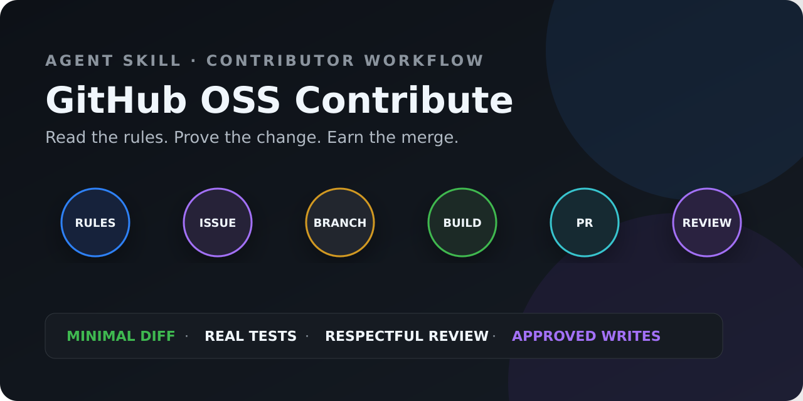

# 🚀 GitHub OSS Contribute

<div align="center">

**Lightweight end-to-end guide for open-source contributors: repo rule recon, Fork/Rebase conflict resolution, DCO/CLA/SSH signing, 2026 AI disclosure, pre-PR local checks, and CI diagnosis.**

[](https://github.com/hyt315/github-oss-contribute/actions/workflows/validate.yml)
[](https://github.com/hyt315/github-oss-contribute/releases/latest)
[](SKILL.md)
[](LICENSE)

[English](./README.en.md) | [中文](./README.md)

</div>



## What is it?

Contributing to an open-source project often stalls on missed repo rules (DCO/CLA, Rulesets, AI policies), messy fork conflicts, or accidentally leaking secrets and local paths in a diff.

`github-oss-contribute` pairs 4 focused manuals with a zero-dependency pre-PR validator (`scripts/validate_contribution.py`):
- **Target-repo rules first**: Inspects `CONTRIBUTING.md`, `AGENTS.md`, branch Rulesets, and AI policy before coding.
- **Diff-scoped pre-PR check**: Scans only commits and added lines introduced on your branch (branch isolation, DCO author-email match, secret & personal-path checks calibrated against placeholders).
- **Approval-gated writes & human authorship**: Fork, push, comment, and PR creation require explicit approval; AI help is disclosed transparently (`Signed-off-by` remains human-only).

## Quick Start

### Option A: Send one sentence to your AI agent (easiest)

> Please install the `github-oss-contribute` skill from `https://github.com/hyt315/github-oss-contribute` into your skills directory and confirm it is ready.

Then ask your agent to help pick an issue, sync your fork, resolve a rebase conflict, fix a DCO check, or diagnose a failing CI run.

### Option B: Install via `npx skills` (90+ agents)

```bash
# Project-level install
npx skills add hyt315/github-oss-contribute

# Global install (recommended)
npx skills add hyt315/github-oss-contribute -g
```

### Option C: Manual clone

```bash
# Claude Code
git clone https://github.com/hyt315/github-oss-contribute.git ~/.claude/skills/github-oss-contribute

# Cursor
git clone https://github.com/hyt315/github-oss-contribute.git ~/.cursor/skills/github-oss-contribute

# Codex / generic Agents directory
git clone https://github.com/hyt315/github-oss-contribute.git ~/.agents/skills/github-oss-contribute
```

### Run pre-PR check & self-tests

```bash
# Run inside your contribution repo (scans only newly added commits & lines)
python3 /path/to/github-oss-contribute/scripts/validate_contribution.py . --base upstream/main

# Skill self-check and unit tests
python3 scripts/validate.py
python3 -m unittest discover tests -v
```

## Repository Structure

```text
github-oss-contribute/
├── SKILL.md                             # Core rules, 4-way phase routing, recon commands & fact card
├── scripts/
│   ├── validate_contribution.py         # Pre-PR branch validator (diff-scoped)
│   └── validate.py                      # Skill package validator (shared secret rules)
├── tests/
│   ├── test_validate_contribution.py    # Pre-PR validator tests
│   └── test_validate.py                 # Package validator tests
├── references/
│   ├── git-and-fork.md                  # Fork/upstream, Rebase conflicts, Git errors & CI diagnosis
│   ├── commits-dco-and-signing.md       # Conventional Commits, DCO/CLA, SSH signing & AI disclosure
│   ├── ai-policy-and-pr-quality.md      # Issue selection, anti-AI slop gate, security & etiquette
│   └── pitfalls-and-access.md           # High-frequency pitfalls & GitHub auth/MCP boundaries
└── .github/workflows/validate.yml       # Python 3.10 / 3.12 matrix CI
```

## Open Source Lifecycle Suite

- **[`github-oss-prep`](https://github.com/hyt315/github-oss-prep)**: Pre-launch prep — deterministic secret/hygiene audit, must-have vs optional polish, modern install conventions, and gated publishing.
- **[`github-oss-ops`](https://github.com/hyt315/github-oss-ops)**: Post-launch operations — triage, AI slop & prompt-injection defense, PR review, PVR/GHSA security SOP, and releases.
- **[`github-oss-contribute`](https://github.com/hyt315/github-oss-contribute)**: Contributor guide — fork sync, rebase conflict handling, DCO signing, AI disclosure, and pre-PR checks.

## License

[MIT](LICENSE). See [CHANGELOG.md](CHANGELOG.md) for version history.
