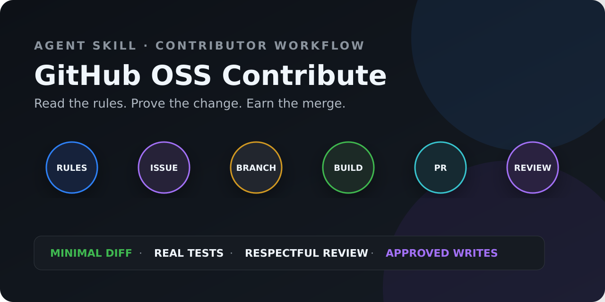

# 🚀 GitHub OSS Contribute / 开源贡献导航

<div align="center">

**面向开源贡献者的轻量化全程导航技能：目标仓库规则侦察、Fork/Rebase 冲突消解、DCO/CLA/SSH 签名、2026 AI 披露规范、提 PR 前本地预检与 CI 排查。**

**Lightweight end-to-end guide for open-source contributors: repo rule recon, Fork/Rebase conflict resolution, DCO/CLA/SSH signing, 2026 AI disclosure, pre-PR local checks, and CI diagnosis.**

[](https://github.com/hyt315/github-oss-contribute/actions/workflows/validate.yml)
[](https://github.com/hyt315/github-oss-contribute/releases/latest)
[](SKILL.md)
[](LICENSE)

[English](./README.en.md) | [中文](./README.md)

</div>



## 这是什么？

给别人的开源项目提 PR，最常卡在规则没看清（DCO/CLA、Rulesets、AI 政策）、直接在 Fork 的 `main` 上开发导致冲突、或者误把本机路径与凭据带进提交。

`github-oss-contribute` 用 4 份精简手册 + 1 个零依赖本地预检脚本（`scripts/validate_contribution.py`），陪你走完从侦察规则到合并 PR 的全过程：
- **目标仓库规则优先**：先查 `CONTRIBUTING.md`、`AGENTS.md`、Rulesets 与 AI 政策再动工。
- **提 PR 前确定性预检**：只扫本分支相对上游新增的提交与新增行（分支隔离、DCO 作者邮箱一致、凭据与个人路径防误报）。
- **审批门禁与作者负责制**：Fork、推送、评论、建 PR 均逐项确认；AI 辅助如实披露（`Signed-off-by` 只能由人签），讲得清原理、跑得通测试再提交。

## 快速开始

### 方式 A：把这句话发给你的 AI 助手（最省事）

> 请帮我安装 `github-oss-contribute` 技能：将 `https://github.com/hyt315/github-oss-contribute` 安装到你的 skills 目录，并确认安装成功。

安装后直接说「帮我给这个仓库挑个 Issue 提 PR」「帮我解决一下 rebase 冲突」「DCO 失败了怎么补签」或「帮我看下这个 PR 的 CI 为什么挂了」即可触发。

### 方式 B：使用 `npx skills` 一键安装（支持 90+ Agent）

```bash
# 安装到当前项目
npx skills add hyt315/github-oss-contribute

# 全局安装（推荐）
npx skills add hyt315/github-oss-contribute -g
```

### 方式 C：手动克隆

```bash
# Claude Code
git clone https://github.com/hyt315/github-oss-contribute.git ~/.claude/skills/github-oss-contribute

# Cursor
git clone https://github.com/hyt315/github-oss-contribute.git ~/.cursor/skills/github-oss-contribute

# Codex / 通用 Agents 目录
git clone https://github.com/hyt315/github-oss-contribute.git ~/.agents/skills/github-oss-contribute
```

### 直接运行提 PR 前预检与自检

```bash
# 在你的贡献仓库里运行（只检查相对上游新增的内容）
python3 /path/to/github-oss-contribute/scripts/validate_contribution.py . --base upstream/main

# 本技能包自检与测试
python3 scripts/validate.py
python3 -m unittest discover tests -v
```

## 文件结构

```text
github-oss-contribute/
├── SKILL.md                             # 主入口：铁律、4 路阶段路由、侦察命令与事实卡
├── scripts/
│   ├── validate_contribution.py         # 提 PR 前本地预检（只查本分支新增提交与新增行）
│   └── validate.py                      # 技能包自检脚本（共用凭据规则）
├── tests/
│   ├── test_validate_contribution.py    # 预检脚本回归测试
│   └── test_validate.py                 # 技能包自检回归测试
├── references/
│   ├── git-and-fork.md                  # Fork/upstream、Rebase 冲突、Git 报错与 CI 排查
│   ├── commits-dco-and-signing.md       # Conventional Commits、DCO/CLA、SSH 签名与 AI 披露
│   ├── ai-policy-and-pr-quality.md      # 选题沟通、反 AI Slop 三问、安全检查与漏洞上报
│   └── pitfalls-and-access.md           # 高频避坑与 GitHub 认证/MCP 权限边界
└── .github/workflows/validate.yml       # Python 3.10 / 3.12 矩阵 CI
```

## 开源生命周期协作套件

- **[`github-oss-prep`](https://github.com/hyt315/github-oss-prep)**：开源前准备——确定性隐私与安全审计、必要/可选门面整理、现代安装范式与授权发布。
- **[`github-oss-ops`](https://github.com/hyt315/github-oss-ops)**：开源后运营——Issue 分流、AI 垃圾与注入防御、PR 审查、PVR/GHSA 安全协同与发版运营。
- **[`github-oss-contribute`](https://github.com/hyt315/github-oss-contribute)**：贡献者导航——Fork 同步、Rebase 冲突处理、DCO 签名、AI 披露与提 PR 前预检。

## 开源协议

本项目采用 [MIT 许可证](LICENSE) 开源，完整版本历史见 [CHANGELOG.md](CHANGELOG.md)。
